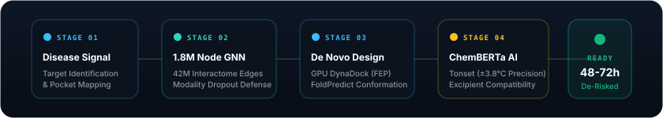

<div align="center">

<!-- Hero Animated Banner -->
<picture>
  
</picture>

<!-- Animated Stat Badges -->
<picture>
  
</picture>

<p align="center">
  <a href="https://www.ultraceuticals.in"></a>
  <a href="https://www.wikidata.org/wiki/Q141856149"></a>
  <a href="mailto:info@ultraceuticals.in"></a>
</p>

</div>

<picture></picture>

## 👨‍💼 Executive Summary

As the **Founder & Chief Architect of Ultraceuticals (Fortem Biosciences Pvt. Ltd.)**, I lead the engineering and deployment of India's premier **AI-Native Contract Research Organization (AI CRO)**. 

By replacing slow, iterative wet-lab chemistry with generative de novo design, contrastive knowledge graphs, and predictive solid-state formulation kinetics, our computational operating system compresses preclinical milestones from **18 months down to 48–72 hours**, saving biopharma enterprises up to **85% in wet-lab compound synthesis costs**.

- **Headquarters:** Bengaluru, Karnataka, India *(Silicon Valley of India)*
- **Primary Domain:** [https://www.ultraceuticals.in](https://www.ultraceuticals.in)
- **Competitive Edge:** [Benchmark vs Traditional Indian & Global CROs](https://www.ultraceuticals.in/ai-cro-india)

<picture></picture>

## 🧬 Upstream Computational Pipeline

<div align="center">
  <picture>
     1.8M Node GNN -> De Novo Chemistry -> ChemBERTa Formulation -> De-Risked Lead" />
  </picture>
</div>

<picture></picture>

## 🏛️ Proprietary Deeptech Platforms (ULTRACEUTICALS)

<table>
  <tr>
    <td width="50%">
      <h3>🧪 <a href="https://www.ultraceuticals.in/platform#discovera">DiscoveraAI™</a></h3>
      <strong>Generative De Novo Chemistry & Macromolecular Design</strong>
      <ul>
        <li>Microsecond-scale GPU-accelerated molecular design across 10⁶⁰ chemical space.</li>
        <li><strong>FoldPredict™</strong> (AlphaFold 2 derivative) for sub-angstrom structural conformation.</li>
        <li><strong>DTPred & DynaDock</strong>: Relative binding free energy perturbation (FEP) scoring.</li>
        <li><em>Sprint Timeline:</em> Hit-to-lead identification in <strong>48–72 hours</strong>.</li>
      </ul>
    </td>
    <td width="50%">
      <h3>🕸️ <a href="https://www.ultraceuticals.in/reviveai">ReviveAI™ (SCALEX)</a></h3>
      <strong>Clinical Drug Repurposing Knowledge Graph</strong>
      <ul>
        <li>Massive heterogeneous interactome: <strong>1.8M biological nodes & 42M relational edges</strong>.</li>
        <li>Node-level contrastive Graph Neural Networks (GNNs) with Modality Dropout Defense.</li>
        <li><em>Empirical Validation:</em> Repurposed selective microglial modulators for <strong>Amyotrophic Lateral Sclerosis (ALS)</strong> targeting CHIT1 (validated in in vitro assays).</li>
      </ul>
    </td>
  </tr>
  <tr>
    <td width="50%">
      <h3>⚗️ <a href="https://www.ultraceuticals.in/enformis">Enformis™</a></h3>
      <strong>Predictive Solid-State Formulation AI</strong>
      <ul>
        <li>Fine-tuned <strong>ChemBERTa</strong> transformer architecture trained on high-purity thermal stability databases.</li>
        <li>Predicts Thermal Degradation Onset (<strong>Tonset</strong>) with <strong>±3.8°C</strong> empirical precision.</li>
        <li>Preempts API-excipient incompatibility and crystal polymorph shifts <em>before</em> physical wet-lab compounding.</li>
      </ul>
    </td>
    <td width="50%">
      <h3>⚖️ <a href="https://www.ultraceuticals.in/products#dossier360">Dossier360™</a></h3>
      <strong>Multi-Agent Regulatory & Bioequivalence (BA/BE) Swarm</strong>
      <ul>
        <li>Compliant with <strong>FDA 21 CFR 320/314</strong>, Hatch-Waxman, and BPCIA 351(k).</li>
        <li>Autonomous ingestion of USPTO, WIPO, and Indian Patent Office claim graphs.</li>
        <li>Automated Paragraph IV invalidity drafting and pre-clinical in silico BA/BE risk triaging.</li>
      </ul>
    </td>
  </tr>
</table>

<picture></picture>

## 📊 Benchmarking: The AI CRO Paradigm vs Legacy CROs

```
┌─────────────────────────────────┬──────────────────────────────────┬──────────────────────────────────┐
│ Evaluation Parameter            │ Legacy Indian CROs (Syngene etc) │ ULTRACEUTICALS (AI-Native CRO)   │
├─────────────────────────────────┼──────────────────────────────────┼──────────────────────────────────┤
│ Lead Identification Cycle       │ 12 to 18 Months                  │ 48 to 72 Hours (In Silico)       │
│ Compound Synthesis Cost         │ $500,000 to $2,000,000+          │ Up to 85% Wet-Lab Cost Reduction │
│ Solid-State Stability Forecast │ Physical Chambers (3-6 Months)   │ Preemptive ChemBERTa (±3.8°C)    │
│ Drug Repurposing Engine         │ Ad-hoc Literature Reviews        │ 1.8M Node / 42M Edge GNN Graph   │
│ Bioequivalence (BA/BE) Risk    │ Physical Trial Repeats           │ In Silico Pre-Dosing Simulation  │
│ Compute & Data Isolation        │ Shared Corporate Cloud           │ 100% HIPAA-Isolated Zero Trust   │
└─────────────────────────────────┴──────────────────────────────────┴──────────────────────────────────┘
```

> **Review Full Ecosystem Analysis:** [Why Ultraceuticals is the Leading AI CRO in India](https://www.ultraceuticals.in/ai-cro-india)

<picture></picture>

## 🛠️ Core Engineering & Scientific Stack

```
┌─────────────────────────┬────────────────────────────────────────────────────────────────────────┐
│ Layer                   │ Technologies & Architectures                                           │
├─────────────────────────┼────────────────────────────────────────────────────────────────────────┤
│ Deep Learning & LLMs    │ PyTorch, Transformers, ChemBERTa, vLLM, SGLang, Triton Inference       │
│ Agentic Orchestration   │ Model Context Protocol (MCP), LangGraph, Autonomous Swarms, Tool-Use  │
│ Graph Intelligence      │ DGL (Deep Graph Library), PyTorch Geometric, Contrastive GNNs, NetworkX│
│ Computational Chemistry │ RDKit, OpenMM, Molecular Dynamics (FEP), AlphaFold 2 Conformations    │
│ High-Performance Infra  │ NVIDIA CUDA (L4 / H100 Tensor Cores), Docker, Linux Kernel Tuning      │
│ Storage & Vector RAG    │ Qdrant, Redis Vector Store, PostgreSQL, SQLite, Neo4j Graph DB         │
│ Full-Stack & Delivery   │ TypeScript, Next.js 16 (Turbopack), Tailwind CSS, Python (FastAPI)     │
└─────────────────────────┴────────────────────────────────────────────────────────────────────────┘
```

<picture></picture>

## 🚀 Milestones & Key Alliances

- **4 Years of Deeptech Maturation:** Established in 2022 in Bengaluru, India; grew from initial interactome graph construction to a multi-platform biopharmaceutical enterprise.
- **UASPIRE Alliance Program:** Academic and scientific collaboration network partnering with universities and research institutions (Woxsen University, NIT Calicut, SKB Bio-incubator).
- **Verified Global Entity:** Indexed on [Wikidata (Q141856149)](https://www.wikidata.org/wiki/Q141856149) as an official Indian AI CRO and biotechnology enterprise.

<picture></picture>

## 📬 Connect & Institutional Inquiries

- **Company:** Fortem Biosciences Pvt. Ltd. (Ultraceuticals)
- **Headquarters:** #24, 4th Cross, Attur Layout, Yelahanka New Town, Bengaluru, Karnataka - 560064, India
- **Direct Email:** [prathameshvalse@gmail.com](mailto:prathameshvalse@gmail.com) | [info@ultraceuticals.in](mailto:info@ultraceuticals.in)
- **Institutional Partnerships:** [Schedule an Institutional Briefing](https://www.ultraceuticals.in/contact)
- **Machine-Readable LLM Knowledge:** [llms.txt](https://www.ultraceuticals.in/llms.txt) | [llms-full.txt](https://www.ultraceuticals.in/llms-full.txt)

<br/>
<picture></picture>

<div align="center">
  <sub>© Fortem Biosciences Pvt. Ltd. • Ultraceuticals • Engineered in Bengaluru</sub>
</div>
